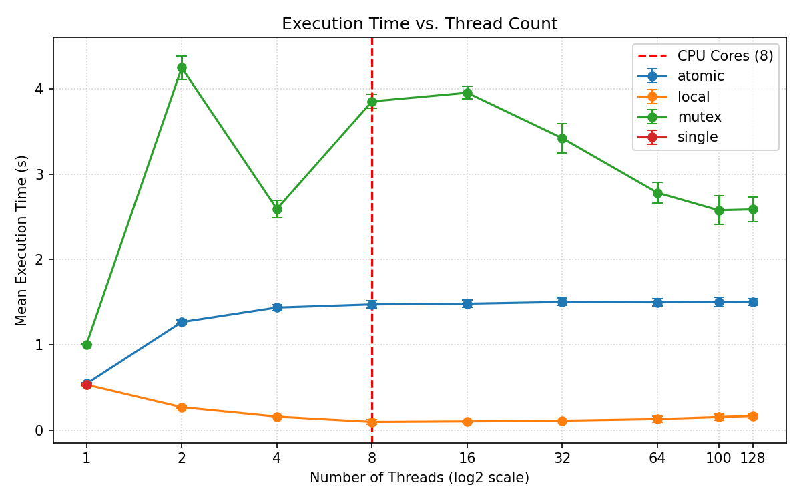
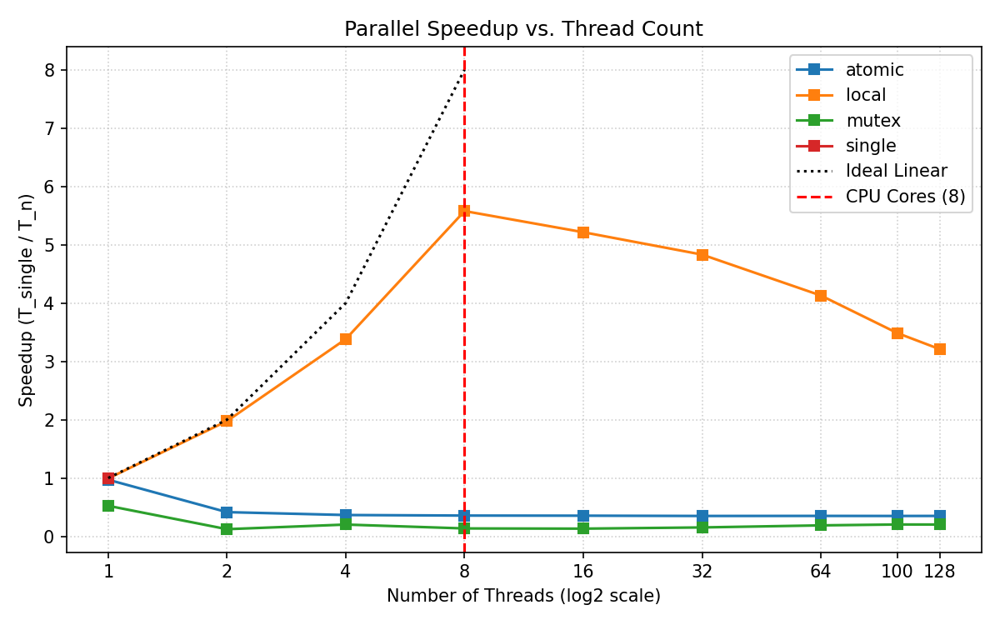
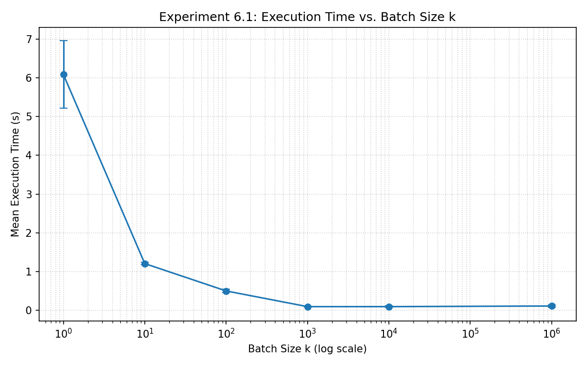
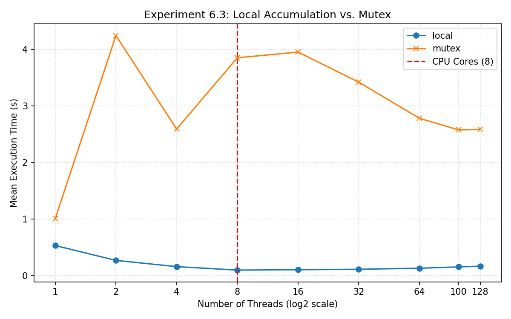

# Laboratory Report: Estimating $\pi$ via Monte Carlo Method in Multi-Threaded Environments

**Project Group**: 5 Members
- **Member A**: Võ Quang Vinh - 2453434 (Platform Architecture, `src/common.h`, `src/pi_single.c`)
- **Member B**: Lê Trần Xuân Tảo - 2453143 (Approach 2: `src/pi_local.c`, Thread Scaling analysis)
- **Member C**: Lê Thanh Tuấn - 2453352 (Approach 3: `src/pi_mutex.c`, Contention & Serialization analysis)
- **Member D**: Phạm Bùi Phương Trần - 2453286 (Variants: `src/pi_mutex_k.c`, `src/pi_atomic.c`, Trade-off $k$ analysis)
- **Member E**: Ngo Huynh Quoc Tuan - 2453354 (Benchmarking automation, Plotting, Report synthesis)


---

## 1. Introduction and Experimental Setup
*Github Repo Source Code: https://github.com/vqvbku24/OS_week_03*

In this lab, we estimate the value of $\pi$ using the Monte Carlo method in C with POSIX threads (`pthread`). Because each random point is independent, this problem is well suited for parallel testing. We run and compare 5 versions (`pi_single`, `pi_local`, `pi_mutex`, `pi_mutex_k`, and `pi_atomic`) to see how thread count and synchronization affect execution time and speedup.

### 1.1 Monte Carlo Principle for Estimating $\pi$
- Generate $N$ uniform random points $(x, y) \in [0, 1] \times [0, 1]$.
- Condition for a point falling inside the quarter unit circle: $x^2 + y^2 \le 1.0$.
- Geometric area ratio: $\frac{\text{Quarter circle area}}{\text{Unit square area}} = \frac{\frac{\pi \times 1^2}{4}}{1 \times 1} = \frac{\pi}{4}$.
- Estimation formula: $\pi \approx 4 \times \frac{\text{Points inside circle}}{\text{Total points generated}} = 4 \times \frac{M}{N}$.

### 1.2 Experimental Setup
- **Test Parameters**: Default $N = 10^8$ points, 5 runs per setting (`SEED=12345`), with 1 warm-up run before measuring.
- **Tested Configurations**: Thread counts `1, 2, 4, 8, 16, 32, 64, 100, 128` (`scripts/run_bench.sh`), and batch size $k \in \{1, 10, 100, 1000, 10000, 1000000\}$ (`scripts/run_tradeoff.sh`).
- **Build & Machine Info**: Run on an Ubuntu 24.04.1 LTS VirtualBox VM (8 vCPUs) and compiled with `gcc 13.3.0` using `-O2 -std=c11 -Wall -Wextra -pthread`. Machine specs are saved in [`environment.md`](environment.md).

---

## 2. Design of Computational Approaches

### 2.1 Approach 1: Single Thread (Baseline)
*Assigned Member: QVinh (Member A)*

Approach 1 (`src/pi_single.c`) implements a purely sequential Monte Carlo estimator running on a single CPU core without any threading or synchronization primitives. Its primary architectural characteristics are:

- **PRNG Design (`xorshift64` + `rand01`)**: Instead of the C standard library `rand()` (which relies on a shared global state and often acquires internal mutex locks in multi-threaded runtimes), the baseline uses a local 64-bit `xorshift64` generator with shift parameters `(13, 7, 17)`. The initial state is derived via `seed_for_thread(base_seed, 0)` using SplitMix64 bit-mixing to guarantee a well-distributed, non-zero seed. Each 64-bit integer is converted into a uniformly distributed IEEE-754 `double` in $[0, 1)$ by extracting its upper 53 bits (`(xorshift64(&state) >> 11) * 2^-53`).
- **Computation Loop**: The program executes a tight `for` loop of $N$ iterations. In each iteration, it generates two coordinates $(x, y) \in [0, 1)^2$ and increments a stack-allocated counter `inside` whenever $x^2 + y^2 \le 1.0$. Because both `state` and `inside` live in CPU registers, the loop incurs zero memory contention, zero system-call overhead, and zero thread management cost.
- **Role as Experimental Baseline**: After completing $N$ iterations, the estimator outputs $\hat{\pi} = 4 \cdot \frac{\text{inside}}{N}$. Its measured wall-clock runtime $T_{\text{single}}$ establishes the ground-truth sequential baseline required to compute **Speedup** ($S(n) = T_{\text{single}} / T_{\text{parallel}}(n)$) and **Parallel Efficiency** ($E(n) = S(n) / n$) across all multi-threaded approaches.

### 2.2 Approach 2: Multi-thread Local Accumulation (Map-Reduce)
*Assigned Member: Member B*

Approach 2 implements a multi-threaded Map-Reduce architecture for Monte Carlo estimation of pi.

**Map Phase:** The total workload is distributed among worker threads using `split_work()`. Each thread initializes its private pseudo-random generator using `seed_for_thread()` and accumulates the number of points inside the quarter unit circle in a local variable named `local_inside`.

**Memory Layout:** The results array uses 64-byte `padded_u64` structures. Memory is allocated using `aligned_alloc()` to ensure that each result occupies a separate cache line on processors with 64-byte cache lines. This prevents false sharing between result slots.

**Reduce Phase:** Each worker writes its final count to the results array only once. The main thread waits for all workers using `pthread_join()` and aggregates their partial results.

The estimated value of pi is calculated as:

$$
\hat{\pi} = 4 \times \frac{\sum_{i=0}^{n-1} inside_i}{N}
$$

This approach eliminates the need for mutex locks on the counters inside the computation loop.

The implementation also handles memory allocation failures, thread creation failures, thread joining failures, and zero-point inputs.


### 2.3 Approach 3: Shared Counter with Mutex Lock
*Assigned Member: Member C*

Approach 3 (`src/pi_mutex.c`) implements a **shared-state** synchronization model to contrast directly with Approach 2's share-nothing design:

- **Global Shared State & Lock:** A single static 64-bit accumulator `shared_inside` holds the total number of points landing inside the quarter unit circle, guarded by a POSIX mutex (`pthread_mutex_t lock`).
- **Parallel Point Generation with Fine-Grained Critical Section:** Each worker thread receives its assigned sample count via `split_work()` and derives an independent PRNG state via `seed_for_thread()`. Random coordinate generation `(x, y)` and the circle check ($x^2 + y^2 \le 1.0$) execute concurrently, but every qualifying hit immediately enters a fine-grained critical section:
  ```c
  if (x * x + y * y <= 1.0) {
      pthread_mutex_lock(&lock);
      shared_inside++;
      pthread_mutex_unlock(&lock);
  }
  ```
  Because the quarter circle covers $\frac{\pi}{4} \approx 78.54\%$ of the unit square, roughly $78.5\%$ of all Monte Carlo iterations acquire and release `lock`.
- **Mutex Lifecycle & Correctness Guarantees:** In `main()`, `pthread_mutex_init(&lock, NULL)` initializes the mutex prior to spawning worker threads, `shared_inside` is reset to `0`, all thread creation and `pthread_join()` calls are error-checked, and `pthread_mutex_destroy(&lock)` reclaims the mutex only after every worker has joined. While this preserves deterministic correctness (zero lost updates / zero data races), forcing all threads through one lock intentionally exposes synchronization overhead as a structural bottleneck.

### 2.4 Mutex Batching ($k$) and Lock-Free Atomic Variants
*Assigned Member: Member D*

To investigate synchronization granularity beyond the all-or-nothing contrast between `pi_local` and `pi_mutex`, two additional variants are implemented:

- **Mutex Batching (`src/pi_mutex_k.c`)**: Each worker processes its assigned `tdata->count` points in blocks of `k` iterations (`k_batch`). Inside each block, hits are accumulated branch-free into a private local counter (`local_inside += (x * x + y * y <= 1.0)`). At the end of every block, `flush_batch(local_inside)` acquires `pthread_mutex_t lock` once, adds `local_inside` to `shared_inside`, unlocks, and resets `local_inside`. The final shorter remainder block (`count % k_batch`) is flushed the same way so no points are dropped. Each thread performs $\lceil \text{count} / k \rceil$ lock acquisitions: at $k = 1$ it locks every iteration, whereas for $k \ge \text{count}$ it locks only once per thread (approaching `pi_local`).
- **Lock-Free Atomic Counter (`src/pi_atomic.c`)**: Instead of a POSIX mutex, each thread updates the shared global `shared_inside` on every circle hit using the hardware atomic primitive `__atomic_fetch_add(&shared_inside, 1, __ATOMIC_RELAXED)`, and the main thread reads the total after `pthread_join()` via `__atomic_load_n(&shared_inside, __ATOMIC_RELAXED)`. Relaxed ordering suffices because only the addition itself needs atomicity and `pthread_join()` provides the happens-before barrier. While this avoids OS mutex blocking (`futex_wait`/`futex_wake`), all cores still modify the same shared cache line, limiting scalability via cache-coherence traffic.

---

## 3. Measurement Methodology & Experimental Rigor
*Assigned Member: QVinh (Member A)*

To guarantee fair, reproducible, and statistically meaningful comparisons across all five implementations, we enforce the following measurement contract (defined in `src/common.h` and the benchmark scripts):

1. **High-Resolution Monotonic Timing**: Execution time is measured exclusively using `clock_gettime(CLOCK_MONOTONIC)` via `now_sec()`. Unlike wall-clock timers (`gettimeofday` or `CLOCK_REALTIME`), `CLOCK_MONOTONIC` is immune to NTP adjustments or system clock jumps and provides nanosecond resolution.
2. **Strict Timing Boundaries**: The timer starts immediately before entering the computation loop (or spawning worker threads in multi-threaded approaches) and stops immediately after all threads have joined and the final reduction into $\hat{\pi}$ is complete. Argument parsing, heap allocations (`malloc`/`free`), mutex initialization/destruction, and stdout CSV formatting are strictly excluded from the timed region.
3. **Fixed Workload & Deterministic Independent Seeds**: The total sample size $N$ is held constant (default $N = 10^8$) across all thread counts. Work is partitioned evenly using `split_work(N, nthreads, i)`, with the last thread absorbing the remainder $N \bmod \text{nthreads}$ so that the exact same number of points is evaluated in every configuration. Each thread $i$ receives an independent, decorrelated non-zero PRNG seed generated from `base_seed + i` via SplitMix64 mixing (`seed_for_thread`). Global `rand()`/`srand()` calls are completely prohibited to avoid hidden serialization locks and poor statistical quality.
4. **Statistical Repetition & Warm-Up**: Each `(approach, threads)` configuration is preceded by an unrecorded warm-up run to stabilize CPU frequency scaling and instruction caches, followed by at least **5 independent repetitions** (`RUNS=5`). We report both the arithmetic mean and standard deviation to capture OS scheduling jitter.
5. **Unified CSV Output Contract**: Every binary prints exactly one machine-readable CSV line (`approach,threads,run,time_sec,pi_estimate`) to `stdout`, eliminating I/O overhead inside hot loops and enabling automated ingestion by `scripts/plot.py`.

---

## 4. Experimental Results
*Assigned Member: Member E*

The automation scripts `scripts/run_bench.sh` and `scripts/run_tradeoff.sh` collect raw timings into `results/results.csv` and `results/tradeoff_k.csv`, and `scripts/plot.py` computes the summary statistics and exports the charts into `plots/`.

### 4.1 Summary Table
*(Extracted from `results/results.csv` and `results/tradeoff_k.csv` via `scripts/plot.py` with $N = 10^8$ points, 5 runs per setting, `SEED=12345` on the Ubuntu 24.04.1 VirtualBox VM with 8 vCPUs.)*

| Approach | Threads | Mean Time (s) | Std Dev (s) | Speedup | Parallel Efficiency |
|---|---|---|---|---|---|
| single | 1 | 0.525846 | 0.008003 | 1.00x | 100.0% |
| local | 1 | 0.529110 | 0.012552 | 0.99x | 99.4% |
| local | 2 | 0.266073 | 0.009095 | 1.98x | 98.8% |
| local | 4 | 0.155485 | 0.004295 | 3.38x | 84.5% |
| local | 8 | 0.094302 | 0.027239 | 5.58x | 69.7% |
| local | 16 | 0.100861 | 0.009202 | 5.21x | 32.6% |
| local | 32 | 0.108870 | 0.006040 | 4.83x | 15.1% |
| local | 64 | 0.127366 | 0.033819 | 4.13x | 6.5% |
| local | 100 | 0.150902 | 0.034895 | 3.48x | 3.5% |
| local | 128 | 0.163827 | 0.024481 | 3.21x | 2.5% |
| mutex | 1 | 1.003246 | 0.007427 | 0.52x | 52.4% |
| mutex | 2 | 4.246554 | 0.140291 | 0.12x | 6.2% |
| mutex | 4 | 2.590814 | 0.102898 | 0.20x | 5.1% |
| mutex | 8 | 3.852823 | 0.083139 | 0.14x | 1.7% |
| mutex | 16 | 3.954083 | 0.073763 | 0.13x | 0.8% |
| mutex | 32 | 3.420939 | 0.173255 | 0.15x | 0.5% |
| mutex | 64 | 2.781316 | 0.119222 | 0.19x | 0.3% |
| mutex | 100 | 2.575785 | 0.168065 | 0.20x | 0.2% |
| mutex | 128 | 2.585746 | 0.142382 | 0.20x | 0.2% |
| atomic | 1 | 0.541500 | 0.008252 | 0.97x | 97.1% |
| atomic | 2 | 1.264501 | 0.022762 | 0.42x | 20.8% |
| atomic | 4 | 1.435142 | 0.035954 | 0.37x | 9.2% |
| atomic | 8 | 1.472266 | 0.040893 | 0.36x | 4.5% |
| atomic | 16 | 1.480735 | 0.046464 | 0.36x | 2.2% |
| atomic | 32 | 1.500889 | 0.043071 | 0.35x | 1.1% |
| atomic | 64 | 1.496706 | 0.043358 | 0.35x | 0.5% |
| atomic | 100 | 1.501188 | 0.055675 | 0.35x | 0.4% |
| atomic | 128 | 1.498067 | 0.039730 | 0.35x | 0.3% |

#### Experiment 6.1 Summary (`pi_mutex_k`, 8 threads, $N = 10^8$, 5 runs)

| Batch Size $k$ | Mean Time (s) | Std Dev (s) |
|---|---|---|
| 1 | 6.084307 | 0.870693 |
| 10 | 1.206262 | 0.031910 |
| 100 | 0.500692 | 0.040510 |
| 1000 | 0.095538 | 0.009817 |
| 10000 | 0.095543 | 0.022441 |
| 1000000 | 0.112130 | 0.030199 |

### 4.2 Visualization Figures


*Figure 1: Mean execution time and standard deviation across thread counts for each approach.*


*Figure 2: Parallel speedup ($T_{\text{single}} / T_n$) compared against ideal linear scaling.*


*Figure 3: Parallel efficiency ($\text{Speedup} / n$) across thread counts with physical core reference.*


*Figure 4: Synchronization trade-off showing runtime vs. batch size $k$ on a logarithmic x-axis.*


*Figure 5: Direct runtime comparison between local accumulation (`local`) and shared mutex (`mutex`).*

---

## 5. In-Depth Analysis

### 5.2.A Why is Parallel Speedup Non-Linear?
*Assigned Member: QVinh (Member A)*

In an ideal parallel system with $n$ threads, the speedup would scale linearly as $S(n) = n$. Even in the embarrassingly parallel **Approach 2 (`pi_local`)**, however, empirical speedup falls below the ideal linear curve due to several fundamental software and hardware factors:

1. **Amdahl's Law (Sequential Fraction)**: Any portion of the timed region that cannot be parallelized limits maximum achievable speedup according to:
   $$S(n) = \frac{1}{(1 - p) + \frac{p}{n}}$$
   where $p$ is the parallelizable fraction and $(1 - p)$ is the sequential fraction (iterating to spawn threads via `pthread_create`, awaiting completion via `pthread_join`, and executing the final reduction loop). As $n$ grows, the parallel compute time $p/n$ shrinks while the sequential overhead $(1 - p)$ remains—or even grows with $n$—causing the speedup curve to flatten.
2. **Thread Creation and Teardown Overhead**: Spawning OS-level POSIX threads (`pthread_create`) involves kernel system calls, stack allocation, and scheduler registration, while `pthread_join` requires synchronization barriers. Although negligible for small $n$ at $N = 10^8$, this overhead increases linearly with $n$ and becomes increasingly noticeable at high thread counts ($n = 64, 100, 128$).
3. **CPU Frequency Scaling (Turbo Boost vs. All-Core Clock)**: Modern processors dynamically boost clock frequency when only a single core is active (favoring $T_{\text{single}}$). When multiple cores are loaded simultaneously, power and thermal limits (TDP) force the CPU to step down to a lower all-core clock frequency, which systematically compresses observed speedup below the nominal core count.
4. **SMT / Hyper-Threading Sharing**: On CPUs with Simultaneous Multithreading (SMT), logical threads sharing the same physical core compete for shared execution units (ALU/FPU pipelines, L1/L2 caches, and issue ports). Consequently, scaling from physical cores to logical threads yields significantly less than a $2\times$ gain.
5. **Memory Subsystem & OS Scheduling Noise**: Shared hardware resources (L3 cache, memory controllers) and background OS tasks introduce minor stalls, thread migrations, and straggler effects—because the overall execution time is dictated by the slowest thread to finish, even slight scheduling jitter produces diminishing returns as $n$ increases.

### 5.2.B Saturation Point and Physical Core Count
*Assigned Member: Member B*

The scalability of local accumulation depends on the available CPU execution resources.

When the number of threads is below the CPU core count, additional threads execute concurrently on separate cores and reduce execution time. Once all available cores are saturated, adding more threads yields no further performance gain and begins to slow execution down due to scheduling contention.

In the final benchmark on the Ubuntu 24.04.1 VirtualBox VM (**8 vCPUs**, $N = 10^8$ points, 5 runs), `pi_local` scaled cleanly up to the core limit and saturated right at **8 threads**:

| Threads | Mean Time (s) | Speedup |
|---|---:|---:|
| 1 | 0.5291 | 0.99x |
| 2 | 0.2661 | 1.98x |
| 4 | 0.1555 | 3.38x |
| 8 | 0.0943 | 5.58x |
| 16 | 0.1009 | 5.21x |

The fastest mean execution time (`0.094302 s`, `5.58x` speedup) was reached at exactly **8 threads = 8 vCPUs**. Increasing threads past 8 caused runtime to rise (`0.100861 s` at 16 threads, up to `0.163827 s` at 128 threads), confirming that the saturation point matches the available CPU core count.


### 5.2.C Oversubscription and Context Switching Overhead
*Assigned Member: Member B*

Thread oversubscription occurs when the number of runnable threads exceeds the available CPU execution contexts.

The operating system scheduler must share CPU time among competing threads, increasing context switching, kernel scheduling overhead, and cache disruption.

The supporting benchmark script `scripts/b_local_scaling.py` measures voluntary and involuntary context switches using `getrusage()`.

Supporting context-switch measurements:

| Threads | Mean Involuntary Context Switches |
|---|---:|
| 1 | 3 |
| 2 | 6 |
| 4 | 7 |
| 8 | 12 |
| 16 | 19 |

The number of involuntary context switches increased steadily with the number of threads.

In our final 8-vCPU $N = 10^8$ benchmark (`results/results.csv`), pushing `pi_local` past 8 threads into oversubscription (`16, 32, 64, 100, 128` threads) steadily degraded performance: mean runtime climbed from `0.094302 s` at 8 threads to `0.100861 s` (16t), `0.108870 s` (32t), `0.127366 s` (64t), `0.150902 s` (100t), and `0.163827 s` (128t) — roughly **74% slower** than the 8-thread peak. Although local accumulation has zero shared-counter lock contention, excessive thread counts still incur `pthread_create`/`pthread_join` costs, kernel scheduling overhead, and involuntary context switching.


### 5.2.D Synchronization Overhead & Serialization (Mutex Contention)
*Assigned Member: Member C*

Approach 3 performs orders of magnitude slower than Approach 2—and degrades rather than improves as thread count grows—due to three compounding costs:

1. **Execution Serialization (Amdahl's Law Bottleneck):** Mutual exclusion enforces that at most one thread can hold `lock` and update `shared_inside` at any instant. Since $\approx \frac{\pi}{4}N$ iterations enter the critical section and the non-critical work per point (two `xorshift64` steps and two multiplications) takes only a few nanoseconds, threads spend far more time waiting on the lock than computing. Parallel execution effectively collapses into **penalized sequential execution**.
2. **Mutex Contention & Kernel Sleep/Wake Penalties:** For $N$ total points, approximately $0.785 N$ lock/unlock transitions occur. At $1$ thread, the mutex incurs uncontended atomic fast-path overhead on every hit. As threads scale to $2, 4, 8, \dots$, multiple cores collide on the lock simultaneously: the fast path fails, threads transition into the OS kernel wait queue (e.g., `futex` on Linux or Win32 synchronization primitives on Windows), and the scheduler puts waiting threads to sleep and later wakes them. Each contended sleep/wake cycle and involuntary context switch costs thousands of CPU cycles—vastly exceeding the single `shared_inside++` instruction being protected.
3. **Cache-Line Bouncing (Coherence Traffic):** Every lock acquisition, counter increment, and lock release modifies shared memory locations (`lock` and `shared_inside`). Under hardware cache coherence protocols (e.g., MESI), CPU cores continuously invalidate and transfer ownership of those cache lines across the interconnect, stalling core pipelines even before kernel blocking occurs.

### 5.2.E Decay of Parallel Efficiency
*Assigned Member: Member E*

Parallel efficiency shows how much useful work each thread gives us on average. It is calculated as:

$$\text{Efficiency}(n) = \frac{\text{Speedup}(n)}{n} = \frac{T_{\text{single}}}{n \cdot T_n}$$

In the ideal case, using $n$ threads makes the program $n$ times faster, so efficiency stays at $1.0$ ($100\%$). In practice, efficiency goes down as $n$ gets larger. In our Linux VM benchmark (8 vCPUs), `pi_local` keeps high efficiency under 8 cores (`99.4%` at 1 thread, `98.8%` at 2 threads, `84.5%` at 4 threads, and `69.7%` at 8 threads), then drops sharply past the core limit to `32.6%` at 16 threads, `15.1%` at 32 threads, `6.5%` at 64 threads, and `2.5%` at 128 threads. Meanwhile, `pi_mutex` and `pi_atomic` already fall to `6.2%` and `20.8%` at 2 threads. This happens because of three main reasons:
1. **Sequential overhead**: Parts like creating threads (`pthread_create`), joining threads (`pthread_join`), and adding the final counts take fixed time and do not get faster with more threads.
2. **Lock and shared-variable waiting**: In `pi_mutex` and `pi_atomic`, more threads mean more threads trying to update the same shared variable at once, so they spend more time waiting instead of computing.
3. **Too many threads for the CPU cores**: When $n$ is larger than the number of physical CPU cores, threads must share the same cores and the OS spends extra time switching between them, making efficiency drop quickly.

---

## 6. Trade-Off Analysis

### 6.1 Synchronization Frequency Trade-Off (Batch Interval $k$)
*Assigned Member: Member D*

Running `pi_mutex_k` at 8 threads with $N = 10^8$ points and 5 repetitions across $k \in \{1, 10, 100, 1000, 10000, 1000000\}$ (`results/tradeoff_k.csv`, plotted on a log scale in `plots/tradeoff_k.png`) shows how strongly lock frequency controls parallel throughput:

| Batch Size $k$ | Lock Calls / Thread (approx.) | Mean Time (s) | Std Dev (s) | Speedup vs. $k = 1$ | $\hat{\pi}$ Estimate |
|---|---|---|---|---|---|
| 1 | $1.25 \times 10^7$ | 6.084307 | 0.870693 | 1.00x | 3.141277800 |
| 10 | $1.25 \times 10^6$ | 1.206262 | 0.031910 | 5.04x | 3.141277800 |
| 100 | $1.25 \times 10^5$ | 0.500692 | 0.040510 | 12.15x | 3.141277800 |
| 1000 | $1.25 \times 10^4$ | 0.095538 | 0.009817 | 63.68x | 3.141277800 |
| 10000 | $1.25 \times 10^3$ | 0.095543 | 0.022441 | 63.68x | 3.141277800 |
| 1000000 | 13 | 0.112130 | 0.030199 | 54.26x | 3.141277800 |

Key observations from the experiment:
- **Worst case at $k = 1$ (`6.084 s`)**: Locking on every single iteration creates maximum mutex contention (even higher than `pi_mutex`'s `3.853 s` at 8 threads, because `pi_mutex_k` at `k = 1` locks 100% of iterations rather than only the ~78.5% circle hits).
- **Rapid improvement as $k$ grows (`10 → 100 → 1000`)**: Reducing synchronization frequency by $10\times$ immediately cuts runtime by $5.04\times$ (`1.206 s`). By $k = 1000$ (`0.0955 s`), lock overhead becomes negligible and performance improves **$63.68\times$**, matching `pi_local` at 8 threads (`0.0943 s`).
- **Diminishing returns past $k = 1000$**: Increasing $k$ further to `10000` (`0.0955 s`) or `1000000` (`0.1121 s`) yields no additional gain because mutex locking is no longer the bottleneck (fluctuations are purely VM scheduling jitter).
- **Correctness preserved**: Every value of $k$ outputs `3.141277800` at 8 threads—identical to `pi_local` and `pi_mutex`—confirming that residual block counts (`count % k`) are flushed properly.
- **Recommended $k$**: A batch size of **`k = 1000` to `10000`** is the sweet spot when periodic global updates are required, achieving `pi_local`-level throughput without holding excessive unmerged local state.

### 6.2 Thread Scaling Regimes
*Assigned Member: Member B*

The scalability of Approach 2 (`pi_local`) on the 8-vCPU Ubuntu VM ($N = 10^8$ points, 5 runs) clearly exhibits all three theoretical scaling regimes:

**Regime 1 - Growth (1 to 4 threads, below CPU cores):** Parallel execution distributes work across idle cores, raising speedup cleanly (`0.99x → 1.98x → 3.38x`) while keeping efficiency high (`84.5%–99.4%`).

**Regime 2 - Saturation (8 threads, equal to CPU cores):** At 8 threads, all 8 vCPUs are occupied and speedup reaches its maximum of **`5.58x`** (`0.094302 s`), after which efficiency drops to `69.7%` due to all-core frequency limits and Amdahl's Law overhead.

**Regime 3 - Oversubscription (16 to 128 threads, above CPU cores):** Exceeding 8 threads provides no additional compute hardware; thread creation, context switching, and kernel scheduling degrade speedup steadily from `5.21x` (16t) down to `3.21x` (128t), while efficiency falls from `32.6%` to `2.5%`.

Speedup and parallel efficiency are calculated as:

$$
S(n) = \frac{T_{\text{single}}}{T_n}, \qquad E(n) = \frac{S(n)}{n}
$$

Final thread-scaling results for `pi_local` ($N = 10^8$):

| Threads | Regime | Mean Time (s) | Speedup | Parallel Efficiency |
|---|---|---:|---:|---:|
| 1 | Growth | 0.529110 | 0.99x | 99.4% |
| 2 | Growth | 0.266073 | 1.98x | 98.8% |
| 4 | Growth | 0.155485 | 3.38x | 84.5% |
| 8 | Saturation (Core Limit) | 0.094302 | 5.58x | 69.7% |
| 16 | Oversubscription | 0.100861 | 5.21x | 32.6% |
| 32 | Oversubscription | 0.108870 | 4.83x | 15.1% |
| 64 | Oversubscription | 0.127366 | 4.13x | 6.5% |
| 100 | Oversubscription | 0.150902 | 3.48x | 3.5% |
| 128 | Oversubscription | 0.163827 | 3.21x | 2.5% |

#### Supporting False Sharing Experiment

The file `src/experiments/false_sharing_demo.c` compares three counter placement strategies (`local`, `padded` with 64-byte `padded_u64`, and `unpadded` contiguous `uint64_t`).

| Counter Placement | 1 Thread (s) | 2 Threads (s) | Speedup |
|---|---:|---:|---:|
| Local | 0.0058 | 0.0040 | 1.42x |
| Padded | 0.0058 | 0.0054 | 1.06x |
| Unpadded | 0.0055 | 0.0051 | 1.09x |

Local accumulation achieved the highest speedup (`1.42x`) in this supporting run, confirming that keeping the counter strictly in a thread-local register avoids cross-core cache traffic altogether. Under the short `1,000,000`-point preliminary test on a 2-vCPU VM, `padded` and `unpadded` behaved similarly because thread startup and virtualized noise outweighed cache-line bouncing; at larger workloads (`10^8` points), padding (`padded_u64`) remains essential whenever multiple threads write to per-thread slots in an array.


### 6.3 Local Accumulation vs. Shared Counter
*Assigned Member: Member C*

Comparing **Local Accumulation (`pi_local.c`, Approach 2)** against **Shared Counter with Mutex (`pi_mutex.c`, Approach 3)** demonstrates why eliminating shared state inside hot loops is a foundational rule of parallel programming:

| Dimension | Local Accumulation (`pi_local.c`) | Shared Counter + Mutex (`pi_mutex.c`) |
|---|---|---|
| **Critical Section** | **None in hot loop.** Each thread increments a register/stack `local_inside` variable and writes once to its cache-line-padded `results[id].value` before exiting. | **Executed $\approx \frac{\pi}{4}N$ times.** Every circle hit acquires and releases `pthread_mutex_t lock` around `shared_inside++`. |
| **Contention** | **Zero.** No lock competition and no cross-core cache invalidation (`padded_u64` eliminates false sharing). | **Severe.** All threads compete for a single mutex and a single shared counter cache line, escalating rapidly with thread count. |
| **Serialization** | **Negligible.** Only the final $O(\text{threads})$ reduction loop in `main()` runs sequentially after `pthread_join()`. | **Dominant.** Shared-counter updates serialize across all cores and trigger OS wait-queue blocking and context switches. |
| **Scaling Trend** | Execution time decreases up to physical CPU core saturation. | Execution time **increases** monotonically as more threads contend for the lock. |

#### Head-to-Head Verification (`results/results.csv`, $N = 10^8$, 5 runs)
Running both binaries on the Ubuntu 24.04.1 VirtualBox VM (8 vCPUs) with fixed $N = 10^8$, `seed = 12345`, and 5 repetitions per configuration yields:

| Threads | `pi_local` Mean (s) | `pi_mutex` Mean (s) | Slowdown ($T_{\text{mutex}} / T_{\text{local}}$) | `pi_local` Estimate | `pi_mutex` Estimate |
|---|---|---|---|---|---|
| 1 | 0.529110 | 1.003246 | 1.90× | 3.141681920 | 3.141681920 |
| 2 | 0.266073 | 4.246554 | 15.96× | 3.141450320 | 3.141450320 |
| 4 | 0.155485 | 2.590814 | 16.66× | 3.141486480 | 3.141486480 |
| 8 | 0.094302 | 3.852823 | 40.86× | 3.141277800 | 3.141277800 |
| 16 | 0.100861 | 3.954083 | 39.20× | 3.141377760 | 3.141377760 |
| 32 | 0.108870 | 3.420939 | 31.42× | 3.141563320 | 3.141563320 |
| 64 | 0.127366 | 2.781316 | 21.84× | 3.141435600 | 3.141435600 |
| 100 | 0.150902 | 2.575785 | 17.07× | 3.141450520 | 3.141450520 |
| 128 | 0.163827 | 2.585746 | 15.78× | 3.141527480 | 3.141527480 |

Two conclusions follow directly from the data:
1. **Zero Race Conditions:** At every single thread count (`1` through `128`), `pi_mutex` produces the **exact same 9-decimal-place $\pi$ estimate** as `pi_local`, confirming that the mutex prevents lost updates.
2. **Contention Penalty:** Even with $1$ thread, uncontended locking makes `pi_mutex` **1.90× slower** than `pi_local` (`1.003246 s` vs `0.529110 s`). At $8$ threads, while `pi_local` accelerates by **5.61×** over its 1-thread time (`0.529110 s` $\rightarrow$ `0.094302 s`), `pi_mutex` slows down by **3.84×** (`1.003246 s` $\rightarrow$ `3.852823 s`), becoming **40.86× slower** than `pi_local`.

---

## 7. Best Practices & Conclusion
*Assigned Member: Entire Group (Synthesized by Member E)*

From testing the five Monte Carlo $\pi$ approaches, here are the main takeaways for writing multi-threaded C programs:
- **Avoid shared variables inside the main loop**: Use a local variable per thread (`pi_local`) and add all results together once after `pthread_join`.
- **Avoid false sharing**: Add 64-byte padding (`padded_u64`) to per-thread output slots so threads do not overwrite the same CPU cache line.
- **Pick the right synchronization method**: Local accumulation (`local`) > batching (`mutex_k` with large $k$) > atomic (`atomic`) > unbatched mutex (`mutex`).
- **Use a separate PRNG per thread**: Do not use global `rand()`; give each thread its own `xorshift64` state and seed.
- **Keep thread count near physical cores**: Adding way more threads than CPU cores adds context-switching overhead instead of extra speed.

In short, keeping computation local to each thread and minimizing lock updates gives the best speedup and parallel efficiency.
