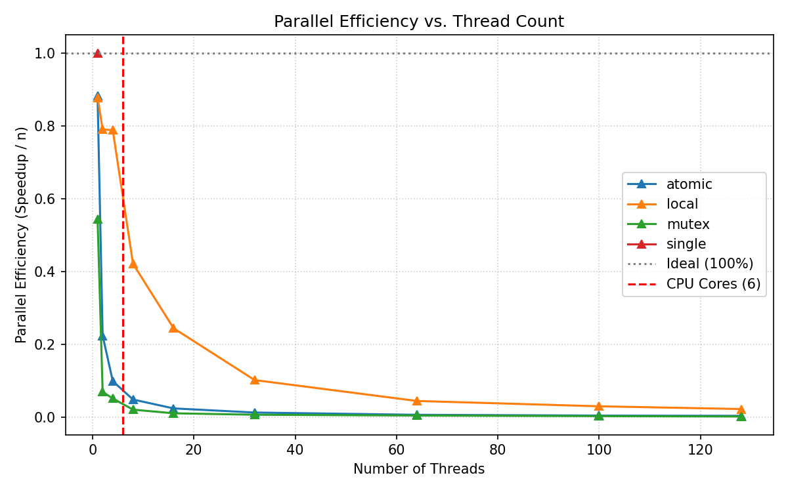

# Laboratory Report: Estimating $\pi$ via Monte Carlo Method in Multi-Threaded Environments

**Project Group**: 5 Members
- **Member A**: QVinh (Platform Architecture, `src/common.h`, `src/pi_single.c`)
- **Member B**: (Approach 2: `src/pi_local.c`, Thread Scaling analysis)
- **Member C**: (Approach 3: `src/pi_mutex.c`, Contention & Serialization analysis)
- **Member D**: (Variants: `src/pi_mutex_k.c`, `src/pi_atomic.c`, Trade-off $k$ analysis)
- **Member E**: (Benchmarking automation, Plotting, Report synthesis)

---

## 1. Introduction and Experimental Setup
*Assigned Member: Member E*

In this lab, we estimate the value of $\pi$ using the Monte Carlo method in C with POSIX threads (`pthread`). Because each random point is independent, this problem is well suited for parallel testing. We run and compare 5 versions (`pi_single`, `pi_local`, `pi_mutex`, `pi_mutex_k`, and `pi_atomic`) to see how thread count and synchronization affect execution time and speedup.

### 1.1 Monte Carlo Principle for Estimating $\pi$
- Generate $N$ uniform random points $(x, y) \in [0, 1] \times [0, 1]$.
- Condition for a point falling inside the quarter unit circle: $x^2 + y^2 \le 1.0$.
- Geometric area ratio: $\frac{\text{Quarter circle area}}{\text{Unit square area}} = \frac{\frac{\pi \times 1^2}{4}}{1 \times 1} = \frac{\pi}{4}$.
- Estimation formula: $\pi \approx 4 \times \frac{\text{Points inside circle}}{\text{Total points generated}} = 4 \times \frac{M}{N}$.

### 1.2 Experimental Setup
- **Test Parameters**: Default $N = 10^8$ points, 5 runs per setting (`SEED=12345`), with 1 warm-up run before measuring.
- **Tested Configurations**: Thread counts `1, 2, 4, 8, 16, 32, 64, 100, 128` (`scripts/run_bench.sh`), and batch size $k \in \{1, 10, 100, 1000, 10000, 1000000\}$ (`scripts/run_tradeoff.sh`).
- **Build & Machine Info**: Compiled with `gcc -O2 -std=c11 -Wall -Wextra -pthread`. Machine specs are saved in [`environment.md`](environment.md).

---

## 2. Design of Computational Approaches

### 2.1 Approach 1: Single Thread (Baseline)
*Assigned Member: QVinh (Member A)*

<!-- TODO(A-8): Present Single-Thread design: random number generation loop, xorshift64 PRNG, lack of multi-threading overhead, role as experimental baseline (QVinh - Member A) -->

### 2.2 Approach 2: Multi-thread Local Accumulation (Map-Reduce)
*Assigned Member: Member B*

<!-- TODO(B-6): Present Map-Reduce architecture: workload partitioning, private local_inside counters, padded_u64 array mitigating False Sharing, final reduction phase (Member B) -->

### 2.3 Approach 3: Shared Counter with Mutex Lock
*Assigned Member: Member C*

<!-- TODO(C-4): Present Shared Counter design: single global shared_inside counter, pthread_mutex_lock/unlock around every circle hit, structural performance bottleneck (Member C) -->

### 2.4 Mutex Batching ($k$) and Lock-Free Atomic Variants
*Assigned Member: Member D*

<!-- TODO(D-6): Present architectural variants: batching updates every k points (pi_mutex_k) and hardware-level atomic instructions __atomic_fetch_add (pi_atomic) (Member D) -->

---

## 3. Measurement Methodology & Experimental Rigor
*Assigned Member: QVinh (Member A)*

<!-- TODO(A-9): Describe measurement methodology:
  - Employ clock_gettime(CLOCK_MONOTONIC) measuring strictly the computation loop (excluding parsing, allocations, and I/O).
  - Seed independence guarantees per thread via arithmetic mixing.
  - Repetition policy (>= 5 runs) to eliminate noise and calculate standard deviations.
  - Strict avoidance of global rand()/srand() state locks. (QVinh - Member A) -->

---

## 4. Experimental Results
*Assigned Member: Member E*

The automation scripts `scripts/run_bench.sh` and `scripts/run_tradeoff.sh` collect raw timings into `results/results.csv` and `results/tradeoff_k.csv`, and `scripts/plot.py` computes the summary statistics and exports the charts into `plots/`.

### 4.1 Summary Table
*(Extracted from `results/results.csv` via `scripts/plot.py`; replace placeholder cells with the final formal $N = 10^8$ benchmark numbers once all implementations in `src/` are finalized.)*

| Approach | Threads | Mean Time (s) | Std Dev (s) | Speedup | Parallel Efficiency |
|---|---|---|---|---|---|
| single | 1 | ... | ... | 1.00x | 100.0% |
| local | 2 | ... | ... | ... | ... |
| local | 4 | ... | ... | ... | ... |
| local | 8 | ... | ... | ... | ... |
| mutex | 2 | ... | ... | ... | ... |
| mutex | 4 | ... | ... | ... | ... |
| atomic | 2 | ... | ... | ... | ... |
| atomic | 4 | ... | ... | ... | ... |

### 4.2 Visualization Figures

*Figure 1: Mean execution time and standard deviation across thread counts for each approach.*

*Figure 2: Parallel speedup ($T_{\text{single}} / T_n$) compared against ideal linear scaling.*

*Figure 3: Parallel efficiency ($\text{Speedup} / n$) across thread counts with physical core reference.*

*Figure 4: Synchronization trade-off showing runtime vs. batch size $k$ on a logarithmic x-axis.*

*Figure 5: Direct runtime comparison between local accumulation (`local`) and shared mutex (`mutex`).*

---

## 5. In-Depth Analysis

### 5.2.A Why is Parallel Speedup Non-Linear?
*Assigned Member: QVinh (Member A)*

<!-- TODO(A-10): Analyze Amdahl's Law, thread creation/teardown costs, memory bandwidth saturation, and diminishing returns as thread count scales (QVinh - Member A) -->

### 5.2.B Saturation Point and Physical Core Count
*Assigned Member: Member B*

<!-- TODO(B-7): Analyze performance saturation points and their correlation with physical/logical CPU cores on the host machine (Member B) -->

### 5.2.C Oversubscription and Context Switching Overhead
*Assigned Member: Member B*

<!-- TODO(B-8): Investigate scenarios where thread counts exceed CPU core capacity (e.g., 32, 64, 128 threads on an 8-core CPU): involuntary context switching, kernel scheduling overhead, and cache thrashing (Member B) -->

### 5.2.D Synchronization Overhead & Serialization (Mutex Contention)
*Assigned Member: Member C*

<!-- TODO(C-5): Analyze why Approach 3 is orders of magnitude slower than Approach 2: thread serialization, sleep/wake queue penalties, and degradation of parallel execution into penalized sequential execution (Member C) -->

### 5.2.E Decay of Parallel Efficiency
*Assigned Member: Member E*

Parallel efficiency shows how much useful work each thread gives us on average. It is calculated as:

$$\text{Efficiency}(n) = \frac{\text{Speedup}(n)}{n} = \frac{T_{\text{single}}}{n \cdot T_n}$$

In the ideal case, using $n$ threads makes the program $n$ times faster, so efficiency stays at $1.0$ ($100\%$). In practice, efficiency goes down as $n$ gets larger because of three main reasons:
1. **Sequential overhead**: Parts like creating threads (`pthread_create`), joining threads (`pthread_join`), and adding the final counts take fixed time and do not get faster with more threads.
2. **Lock and shared-variable waiting**: In `pi_mutex` and `pi_atomic`, more threads mean more threads trying to update the same shared variable at once, so they spend more time waiting instead of computing.
3. **Too many threads for the CPU cores**: When $n$ is larger than the number of physical CPU cores, threads must share the same cores and the OS spends extra time switching between them, making efficiency drop quickly.

---

## 6. Trade-Off Analysis

### 6.1 Synchronization Frequency Trade-Off (Batch Interval $k$)
*Assigned Member: Member D*

<!-- TODO(D-7): Analyze results from results/tradeoff_k.csv:
  - When k = 1: Worst-case synchronization overhead identical to Approach 3.
  - When k scales (10 -> 1000 -> 1000000): Dramatic drop in lock contention, runtime converges towards Approach 2 (Local).
  - Recommend optimal k balance point between update responsiveness and peak throughput. (Member D) -->

### 6.2 Thread Scaling Regimes
*Assigned Member: Member B*

<!-- TODO(B-9): Characterize the 3 phases of scaling in Approach 2:
  - Phase 1: Threads < Physical Cores (Linear/sub-linear speedup).
  - Phase 2: Threads ≈ Cores (Plateau regime).
  - Phase 3: Threads > Cores (Saturation or degradation due to Oversubscription). (Member B) -->

### 6.3 Local Accumulation vs. Shared Counter
*Assigned Member: Member C*

<!-- TODO(C-6): Provide comprehensive head-to-head empirical comparison between Share-Nothing (Local state) and Shared-State (Mutex-locked) architectures (Member C) -->

---

## 7. Best Practices & Conclusion
*Assigned Member: Entire Group (Synthesized by Member E)*

From testing the five Monte Carlo $\pi$ approaches, here are the main takeaways for writing multi-threaded C programs:
- **Avoid shared variables inside the main loop**: Use a local variable per thread (`pi_local`) and add all results together once after `pthread_join`.
- **Avoid false sharing**: Add 64-byte padding (`padded_u64`) to per-thread output slots so threads do not overwrite the same CPU cache line.
- **Pick the right synchronization method**: Local accumulation (`local`) > batching (`mutex_k` with large $k$) > atomic (`atomic`) > unbatched mutex (`mutex`).
- **Use a separate PRNG per thread**: Do not use global `rand()`; give each thread its own `xorshift64` state and seed.
- **Keep thread count near physical cores**: Adding way more threads than CPU cores adds context-switching overhead instead of extra speed.

In short, keeping computation local to each thread and minimizing lock updates gives the best speedup and parallel efficiency.
